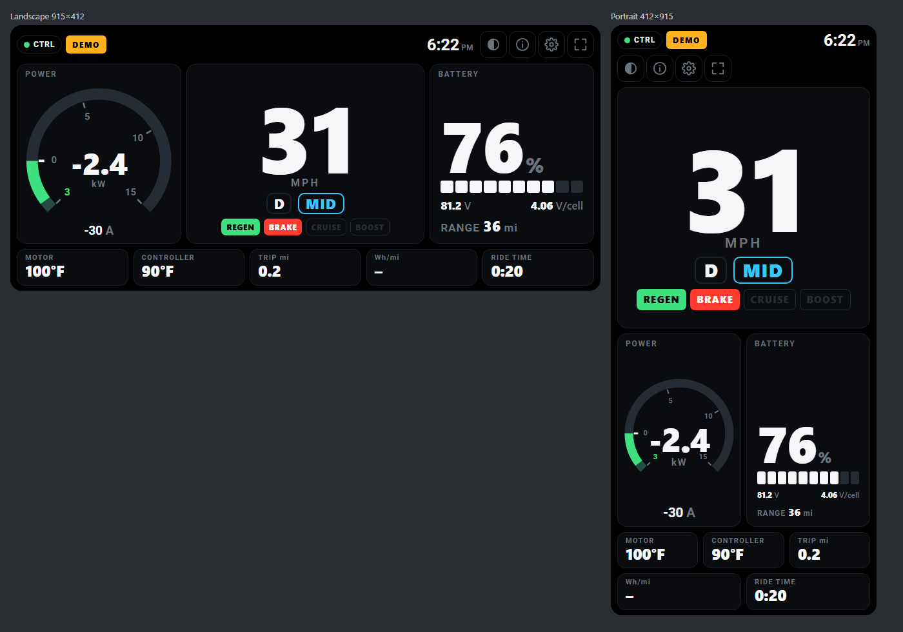

# eMoto Dash

A bar-mount motorcycle dashboard for e-motos running a **Fardriver** controller. It is a web app
(PWA) that talks to the controller directly over Web Bluetooth, using the protocol
reverse-engineered in `../FARDRIVER REVERSE ENGINEERING/analysis/`.



## What it shows

| Area | Contents |
|---|---|
| Centre | **Speed** (mph or km/h), gear (**N / D / R**), ride mode from the 3-speed switch (renameable), tell-tales: **REGEN**, **BRAKE**, **CRUISE**, **BOOST** |
| Left | **Power** arc gauge in kW: blue for drive, green going backwards for regen (amber near max), plus battery current in A |
| Right | **SOC %** as a big number and 10-segment bar, pack voltage, volts per cell, **estimated range** |
| Bottom | Motor and controller temperature (amber/red past your thresholds), trip distance, Wh/mi, ride time |
| Top | Link status, alert banner, clock, day/night toggle, diagnostics, settings, full screen |

How the **REGEN** light works: an outline means regen (EABS) is enabled on the controller. It
fills solid green when the battery current goes negative, which means energy is actually flowing back.

The **alert banner** shows the most important item first:
- controller faults (hall, throttle, over/under-voltage, MOSFET, over-temp…)
- critical temperatures
- lost controller signal
- low battery

**Diagnostics (ⓘ)** lists every decoded value: RPM, phase currents, throttle voltage,
modulation, field weakening, fault and state bits, firmware, frames per second.

## Putting it on your phone

Web Bluetooth needs **Chrome on Android**, and the page has to be served over **HTTPS** (or
`localhost`). iPhones are not supported: Safari has no Web Bluetooth.

**Option A: GitHub Pages (simplest, works offline after the first load)**
1. Create a GitHub repository and upload the contents of this `emoto-dash` folder.
2. In the repository, go to *Settings → Pages* and deploy from the `main` branch, `/ (root)`.
3. On the phone, open `https://<you>.github.io/<repo>/` in Chrome. Use *⋮ → Add to Home screen*
   so it opens full screen like an app.

Any static HTTPS host works the same way (Netlify, Cloudflare Pages, …). There is no build step.

**Option B: from this PC over USB (for development)**
1. Run `npm run serve` (or `python -m http.server 8080`) in this folder.
2. Connect the phone with USB debugging on and run `adb reverse tcp:8080 tcp:8080`.
3. Open `http://localhost:8080` in Chrome on the phone.

## First-time setup

Open **Settings** (gear icon):

1. **Tire outer diameter**: measure it or work it out from the tire size. Speed is computed from
   motor RPM × tire circumference.
2. **Motor : wheel ratio**: 1 for a hub motor. For a chain or belt drive, use rear sprocket teeth
   ÷ front sprocket teeth.
3. **Battery**: cells in series and amp-hours. These drive volts per cell and the range estimate.
4. **Calibrate speed with GPS**: ride at a steady speed above 15 mph for about 10 seconds. The app
   compares GPS speed with RPM-derived speed and stores the correction factor.
5. **Ride modes**: rename switch positions 1–3 to match your bike, e.g. ECO / CITY / SPORT.

Then tap **Connect controller** and pick it from Chrome's list. Its Bluetooth name was not in the
captured logs, so all nearby devices are listed. Use the full-screen button (⛶) when mounted. It also
locks the current orientation, and the screen is kept awake while connected.

Chrome may make you pick the controller again on every launch. If so, enable
`chrome://flags/#enable-web-bluetooth-new-permissions-backend`, which lets the app reconnect to the
remembered device on its own. Mid-ride dropouts are reconnected automatically either way.

Try **Demo ride** first to see everything move without the bike. The demo generates genuine
controller frames, so it exercises the real decoder.

## Safety and behaviour

- The app only **reads** from the controller. The one thing it sends is the same keep-alive
  packet the official app sends (`AA 13 EC 07 09 5F 18 E7`, once a second; this can be turned off
  in Settings). It never writes controller parameters.
- Set everything up before riding. Nothing on the dash needs touching while moving.
- Range is an estimate. It uses the pack's nominal energy and your trip consumption, or the
  "typical consumption" setting until you have ridden 1 mile.

## Verified vs. not yet verified

Verified against the recorded Bluetooth session (`npm test` replays all 3,947 frames from it):
voltage, current, power, RPM, SOC, temperatures, gear, the 3-position mode switch, the brake flag,
the regen-enabled flag, firmware, pole pairs, and the absence of false alarms.

Taken from the official app's logic but **not seen in the recording**:
- the **CRUISE** and **BOOST** bits
- fault bits (no faults occurred)
- the newer controller frame format (your controller uses the legacy format)

If a tell-tale behaves oddly, the raw bits are in Diagnostics.

## Development

```
npm test                 # protocol + dash logic tests (Node 18+), including the capture replay
npm run serve            # static server on :8080
# then open http://localhost:8080/preview.html for landscape + portrait phone frames in demo mode
```

URL options: `?demo=1` starts the demo, `&faults=1` simulates a fault, `&theme=day`, and `&nosw=1`
skips the offline cache. After changing files, bump `VERSION` in `sw.js` so installed copies update.

```
js/protocol/fardriver.js   frame parsing, checksums, decoding, fault names, command builder
js/sources/fardriver-ble.js  Web Bluetooth link: connect, notifications, keep-alive, auto-reconnect
js/sources/demo.js         simulated ride emitting real legacy frames
js/sources/bms.js          contract for a future BMS source
js/store.js                telemetry sections, derived dash values, trip computer, alerts
js/settings.js             settings schema and defaults (the settings form is generated from it)
js/ui/                     dash renderer, power gauge, settings/diagnostics panels
```

### Adding a Bluetooth BMS later

The telemetry store has a separate `bms` section, and the dash already prefers fresh BMS values
over the controller's own SOC and voltage estimates. The top-bar **BMS** pill appears once a BMS
source exists.

To add one, implement a source with the interface described in `js/sources/bms.js`: an
`EventTarget` that emits `status` and `data` events. Then pass it to `connectBms()` in `main.js`.
Which protocol to implement depends on the BMS brand (JBD/Xiaoxiang, JK, Daly, ANT…). A
Bluetooth capture from the BMS's own app, like the one used for the controller, is the fastest way
to confirm it.
